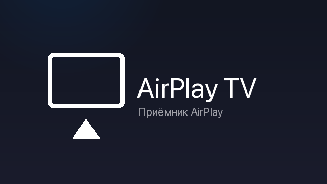
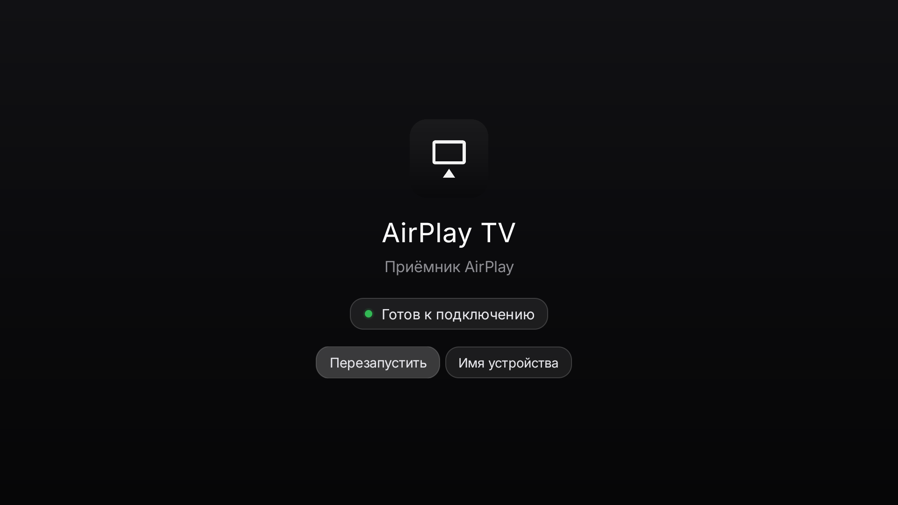
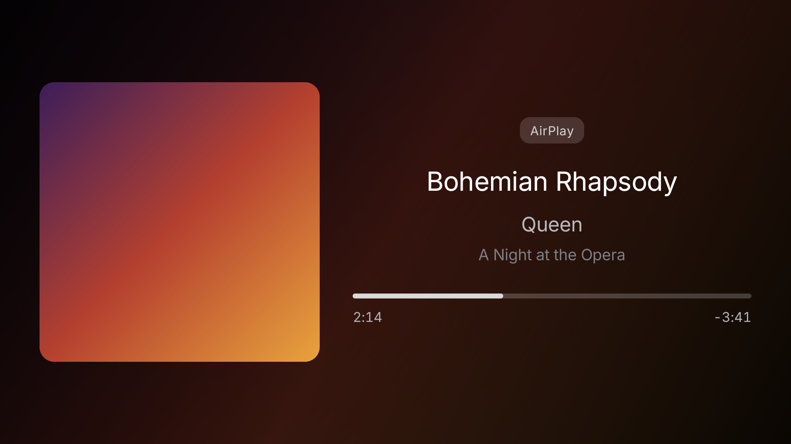
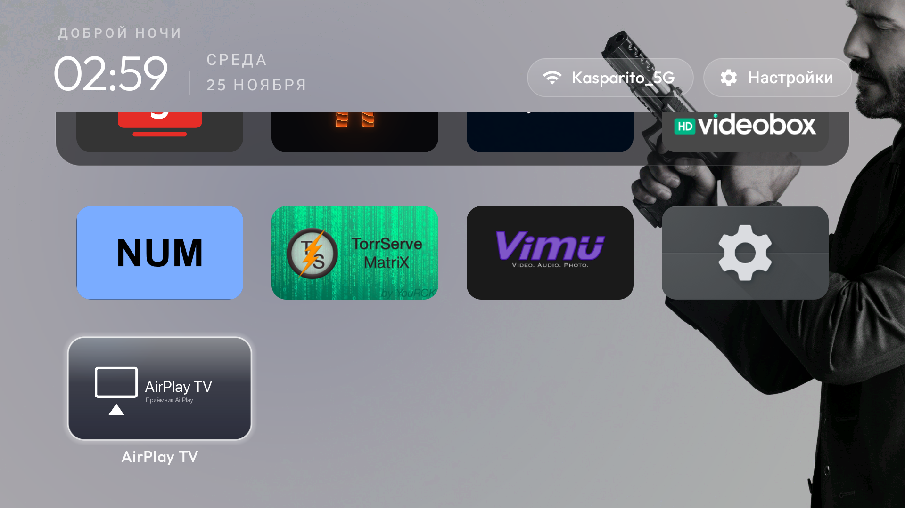

# AirPlay TV

**Turn any Android TV into an AirPlay receiver in one APK.**
Mirror an iPhone or Mac screen, or play Apple Music losslessly — without ads, accounts or a subscription.

[Русская версия](README.ru.md) · [Download](../../releases/latest) · [How to install](#install)




## Screenshots

| Ready to connect | Apple Music |
|---|---|
|  |  |

| In the TV launcher | Mirroring |
|---|---|
|  | Letterboxed / filled / cropped modes |

## What it does

- 📺 **Screen mirroring.** iPhone, iPad and Mac appear in *Screen Mirroring* and show the whole screen on the TV: video, apps, games, presentations.
- 🎵 **Apple Music.** Lossless ALAC is decoded on the TV itself, bit-exactly. Cover art, title, artist, album and a live timeline are shown on screen.
- 🏷 **See who is casting.** The player and the mirroring badge show the sender's name: "iPhone (Nikita)" or "MacBook Air".
- 🔉 **Volume is remembered.** A new cast starts at the level the previous one ended with, not at maximum. The phone still controls the volume and sees the real value.
- 🔁 **It is part of the TV.** The receiver starts by itself after boot and after an update, appears when you cast, and goes back to the TV when the cast ends.
- 🎮 **TV remote control.** OK pauses and resumes the music, left/right switch tracks.
- 🖼 **Three screen formats.** Fit, fill, or fill-and-crop — for vertical videos and 4:3 content.
- 🩺 **Self-healing.** A watchdog checks the receiver and mDNS every 30 seconds and restarts them if they died; after a Wi-Fi change the receiver re-announces itself on the network.

## What it does **not** do

We would rather be honest than look bigger:

- ❌ **No video casting from Safari or the Apple TV app.** Apple protects those streams with FairPlay Streaming, whose keys are not public. This is a hard limit for every third-party receiver, not a bug.
- ❌ **No DRM content from Netflix, Apple TV+, Disney+ and similar.** Same reason.
- ❌ No AirPlay 2 multi-room audio.
- ❌ One sender at a time.
- ❌ No PIN code yet (anyone on your Wi-Fi can connect).

## Requirements

- Android TV or Google TV, **Android 5.0+**, any CPU (ARM, ARM64, x86).
- The phone/Mac and the TV on the same local network (multicast must work — guest Wi-Fi with client isolation will not).
- About **305 KB** of free space.

## Install

1. Download the APK from the [latest release](../../releases/latest) — a file named `AirPlayTV-<version>.apk`.
2. Install it on the TV: `adb install -r AirPlayTV-<version>.apk`, or copy it to a USB drive and open it with a file manager.
3. Open the app once and allow two permissions when asked:
   - **Display over other apps** — so the receiver can come to the front when you cast;
   - **Usage access** — so it waits until you stop using the remote before taking the screen.
4. Done. From now on it starts by itself.

## Usage

**Screen mirroring**

1. On iPhone: Control Center → *Screen Mirroring* → choose the TV.
2. On Mac: Control Center → *Screen Mirroring* → choose the TV.

**Apple Music**

1. Play a track and tap the AirPlay icon **inside the Music app** (not Screen Mirroring).
2. The TV shows the cover, the title and the timeline.

**Remote**

| Key | Action |
|---|---|
| OK / Play | pause / resume |
| ◀ / ▶ | previous / next track |
| MENU | change screen format (mirroring only) |

## How it works

Everything runs on the TV. The app is a complete AirPlay receiver written in Kotlin:

```
app/    Android UI, MediaCodec video, AudioTrack audio, service, remote
core/   protocol: mDNS, HTTP/RTSP, pairing, FairPlay, ALAC, H.264 depacketizer
```

- discovery with its own mDNS responder (`_airplay._tcp`, `_raop._tcp`);
- transient AirPlay 2 pairing (Ed25519 + X25519) and FairPlay key exchange;
- screen mirroring: H.264 over TCP, AES-128-CTR, `MediaCodec` straight to the surface;
- mirroring audio: AAC-ELD over RTP/UDP, with a reorder buffer and duplicate removal;
- Apple Music: ALAC over RTP/UDP, decoded by our own bit-exact lossless decoder;
- sender name and volume come from AirPlay's own plist messages; the volume is persisted;
- the UI is set in Inter (Latin + Cyrillic subset, ~60 KB);
- no native libraries: the APK has no `.so` files at all.

## Build

```bash
./build.sh            # debug APK
./build.sh release    # minified release APK
./build.sh install    # build and install over adb
./build.sh verify     # protocol self-tests (JVM)
```

Requires JDK 17 and Android SDK 35. The `TOOLS` environment variable points to the toolchain directory.

## Tests

`./build.sh verify` runs, on a plain JVM, checks for: binary plist, X25519/Ed25519 (RFC 7748/8032 vectors), AES-CTR/CBC (NIST vectors), FairPlay (differential test against a reference implementation), ALAC (bit-exact comparison with Apple's `afconvert`), mDNS (live discovery through `dns-sd`), RTSP, the mirroring transport, and the full pairing/handshake sequence.

## License

GPLv3. See [LICENSE](LICENSE).

The FairPlay key handling is derived from the publicly available reference implementations (RPiPlay, UxPlay, OmgHax), which is why the project is GPLv3. The ALAC decoder is a port of Apple's Apache-2.0 reference code. Protocol work stands on the shoulders of RPiPlay, UxPlay and shairport-sync — thank you.
The UI is set in [Inter](https://rsms.me/inter/) (SIL Open Font License 1.1), a legal, metrically close stand-in for Apple's SF Pro, which cannot be redistributed. Latin and Cyrillic are embedded as an APK subset; the licence is in `app/src/main/assets/fonts/OFL.txt`.
