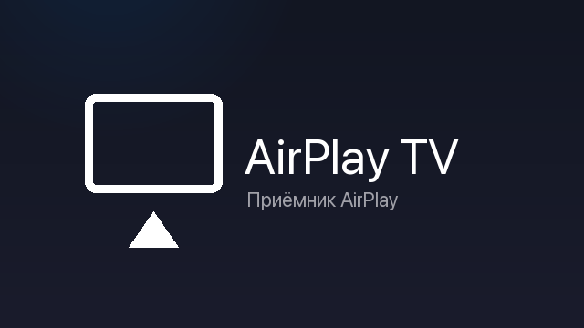
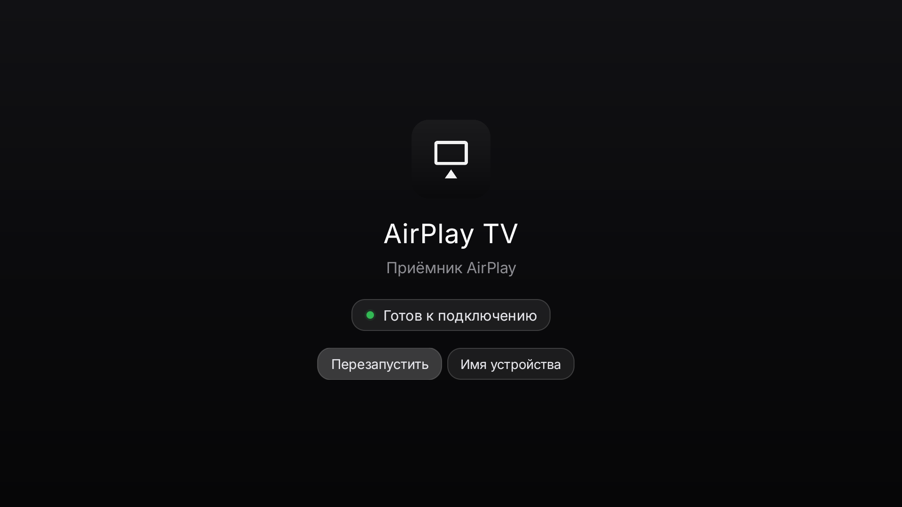
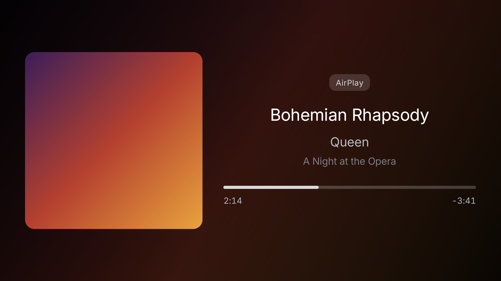
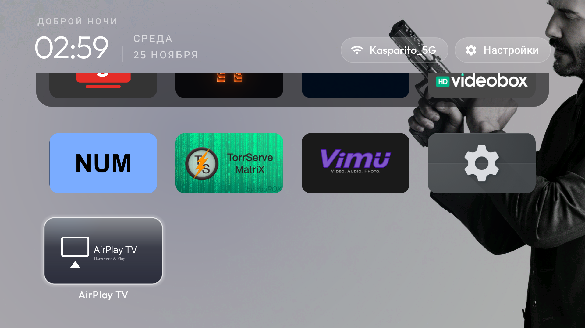

# AirPlay TV

**Превращает любой Android TV в AirPlay-приёмник одним APK.**
Повтор экрана с iPhone или Mac и Apple Music без потерь — без рекламы, аккаунтов и подписок.

[English version](README.md) · [Скачать](../../releases/latest) · [Установка](#установка)




## Скриншоты

| Готов к подключению | Apple Music |
|---|---|
|  |  |

| В меню телевизора | Повтор экрана |
|---|---|
|  | Режимы: по размеру / заполнить / обрезать |

## Что умеет

- 📺 **Повтор экрана.** iPhone, iPad и Mac появляются в «Повторе экрана» и показывают на телевизоре весь экран: видео, приложения, игры, презентации.
- 🎵 **Apple Music.** Lossless ALAC декодируется на самом телевизоре, побитово точно. На экране — обложка, название, исполнитель, альбом и живой таймлайн.
- 🏷 **Видно, кто подключён.** На экране плеера и при зеркалировании показывается имя отправителя: «iPhone (Никита)» или «MacBook Air».
- 🔉 **Громкость запоминается.** Новый каст начинается с того уровня, на котором закончился прошлый, а не с максимума. Телефон по-прежнему управляет громкостью и видит реальное значение.
- 🔁 **Работает как часть телевизора.** Приёмник запускается сам после включения и после обновления, выходит на экран при подключении и возвращает вас в систему, когда трансляция закончилась.
- 🎮 **Управление с пульта.** OK — пауза и продолжение, влево/вправо — переключение треков.
- 🖼 **Три формата экрана.** По размеру, заполнить и заполнить с обрезкой — для вертикальных видео и контента 4:3.
- 🩺 **Самовосстановление.** Сторож каждые 30 секунд проверяет приёмник и mDNS и поднимает их, если что-то отвалилось; после смены Wi-Fi приёмник заново объявляет себя в сети.

## Чего **не** умеет

Мы предпочитаем быть честными, чем казаться больше:

- ❌ **Не выводит видео из Safari и приложения Apple TV.** Apple защищает такие потоки через FairPlay Streaming, ключи закрыты. Это общий предел для всех сторонних приёмников, а не наша недоработка.
- ❌ **Не играет DRM-контент** (Netflix, Apple TV+, Disney+ и подобные) — по той же причине.
- ❌ Нет мультирума AirPlay 2.
- ❌ Один отправитель одновременно.
- ❌ Пока нет PIN-кода (подключиться может любой в вашей сети).

## Требования

- Android TV или Google TV, **Android 5.0+**, любой процессор (ARM, ARM64, x86).
- Телефон/Mac и телевизор в одной локальной сети (нужен multicast; гостевой Wi-Fi с изоляцией клиентов не подойдёт).
- Около **305 КБ** свободного места.

## Установка

1. Скачайте APK из [последнего релиза](../../releases/latest) — файл вида `AirPlayTV-<версия>.apk`.
2. Установите на телевизор: `adb install -r AirPlayTV-<версия>.apk` или скопируйте на флешку и откройте файловым менеджером.
3. Запустите приложение один раз и разрешите две вещи:
   - **Показ поверх других приложений** — чтобы приёмник выходил вперёд при подключении;
   - **Доступ к статистике использования** — чтобы не отбирать экран, пока вы пользуетесь пультом.
4. Дальше всё работает само.

## Как пользоваться

**Повтор экрана**

1. iPhone: Пункт управления → «Повтор экрана» → выбрать телевизор.
2. Mac: Пункт управления → «Повтор экрана» → выбрать телевизор.

**Apple Music**

1. Включите трек и нажмите значок AirPlay **в самом приложении Музыка** (не «Повтор экрана»).
2. На телевизоре появятся обложка, название и таймлайн.

**Пульт**

| Кнопка | Действие |
|---|---|
| OK / Play | пауза / продолжить |
| ◀ / ▶ | предыдущий / следующий трек |
| MENU | сменить формат экрана (только при зеркалировании) |

## Как устроено

Всё работает на телевизоре. Приложение — полноценный AirPlay-приёмник, написанный на Kotlin:

```
app/    интерфейс Android, видео через MediaCodec, звук через AudioTrack, сервис, пульт
core/   протокол: mDNS, HTTP/RTSP, спаривание, FairPlay, ALAC, разбор H.264
```

- обнаружение через собственный mDNS-ответчик (`_airplay._tcp`, `_raop._tcp`);
- транзиентное спаривание AirPlay 2 (Ed25519 + X25519) и обмен ключами FairPlay;
- зеркалирование: H.264 по TCP, AES-128-CTR, `MediaCodec` напрямую в поверхность;
- звук зеркалирования: AAC-ELD по RTP/UDP с буфером переупорядочивания и отбрасыванием дублей;
- Apple Music: ALAC по RTP/UDP, собственный lossless-декодер, проверенный побитово;
- имя отправителя и громкость — из служебных plist-сообщений AirPlay, громкость хранится в настройках;
- интерфейс набран шрифтом Inter (подмножество латиницы и кириллицы, ~60 КБ);
- никаких нативных библиотек: в APK нет ни одного `.so`.

## Сборка

```bash
./build.sh            # debug APK
./build.sh release    # оптимизированный release APK
./build.sh install    # собрать и установить через adb
./build.sh verify     # самотесты протокола (JVM)
```

Нужны JDK 17 и Android SDK 35. Путь к тулчейну задаётся переменной `TOOLS`.

## Тесты

`./build.sh verify` прогоняет на обычной JVM: binary plist, X25519/Ed25519 (векторы RFC 7748/8032), AES-CTR/CBC (векторы NIST), FairPlay (дифференциальный тест против эталонной реализации), ALAC (побитовое сравнение с `afconvert` от Apple), mDNS (живое обнаружение через `dns-sd`), RTSP, транспорт зеркалирования и полную последовательность спаривания.

## Лицензия

GPLv3. См. [LICENSE](LICENSE).

Обработка ключей FairPlay портирована из публичных эталонных реализаций (RPiPlay, UxPlay, OmgHax) — поэтому проект под GPLv3. ALAC-декодер — порт открытого кода Apple (Apache 2.0). Протокольная работа опирается на RPiPlay, UxPlay и shairport-sync — спасибо их авторам.
Интерфейс набран шрифтом [Inter](https://rsms.me/inter/) (SIL Open Font License 1.1) — это легальный близкий аналог SF Pro от Apple; сам SF Pro распространять нельзя. Кириллица и латиница включены в APK подмножеством, лицензия лежит в `app/src/main/assets/fonts/OFL.txt`.
